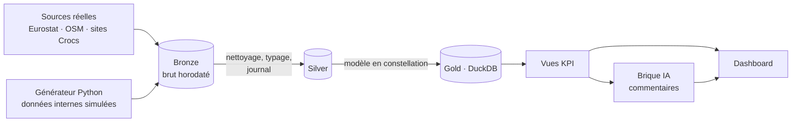
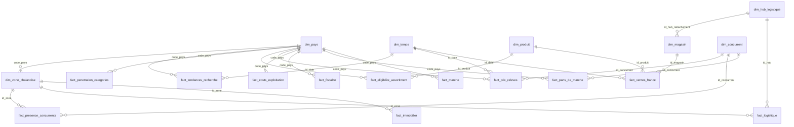

# Crocs France → Allemagne : étude d'implantation 2027-2029

> Projet Data Analytics — Eugenia School · Restitution Comex le 13/11/2026
>
> **Question du Comex : l'ouverture d'un réseau de magasins Crocs en propre en Allemagne est-elle réalisable et rentable ?**

| Livrable | Emplacement |
|---|---|
| Dépôt & documentation | ce README, `docs/` |
| Dashboard + synthèse IA | `dashboard/` (lien en tête de dossier) |
| Slides Comex | `slides/` |

---

## Équipe

| Membre | Rôle |
|---|---|
| Jean-Li Sek | Tech lead : dépôt, CI, pipeline bronze → silver → gold |
| Mehdi Zitouni | Collecte : scraping, API, journal de nettoyage |
| Alexis Sapone | Modélisation & KPIs : couche gold, business case, scoring |
| Briac Truquety | Brique IA : commentaires et synthèse Comex |
| Aurélie Périchon | Restitution : dashboard, slides, cohérence du discours |

Le détail des tâches est dans [`TACHES.md`](TACHES.md).

Chaque membre commence par sa fiche : [`docs/equipe/`](docs/equipe/).

---

## 1. Présentation de l'entreprise

### Le scénario

**Crocs France** est la filiale française du groupe coté Crocs, Inc. (Nasdaq : CROX). Elle exploite un réseau intégré de magasins aux marques Crocs et HEYDUDE.

En Allemagne, la marque est **déjà vendue par des revendeurs** (Zalando, Deichmann…). Dans nos données, elle y pèse 14,0 % du segment casual moulé & sandales en 2025. Le Comex se demande s'il faut **ouvrir un réseau de magasins en propre** sur la période 2027-2029.

> **Scénario fictif, limite assumée.** En réalité, Crocs, Inc. possède déjà quelques boutiques en Allemagne. Nous traitons cette présence réelle comme un indice que le marché existe, pas comme une donnée de l'étude.

### Périmètre France (données simulées)

| Élément | Valeur |
|---|---|
| Réseau (X) | **48 magasins physiques** : 25 en centres commerciaux, 14 en centre-ville, 5 outlets, 4 en gares et aéroports. Trois ont fermé entre 2023 et 2025 : 45 sont ouverts |
| E-commerce | crocs.fr, environ 37 % du CA HT |
| CA net TTC | 40 M€ (2023) → 50 M€ (2024) → 53 M€ (2025) |
| Logistique | Hubs de Moissy-Cramayel (IDF) et Saint-Quentin-Fallavier (Lyon), centre de distribution EMEA à Dordrecht (Pays-Bas) |

### Catalogue

147 SKU (30 modèles × coloris) : sabots, sandales, bottes, Jibbitz (charms), chaussures toile HEYDUDE.

### Pays ciblé : Allemagne

C'est le plus gros marché de l'Union européenne sur notre segment. Cinq autres pays (Espagne, Italie, Belgique, Pays-Bas, Royaume-Uni) servent de **benchmark** pour justifier ce choix.

---

## 2. Cadrage & dictionnaire de données

### 2.1 Les 5W

| | |
|---|---|
| **Why** | Trouver un relais de croissance pour 2027-2029 |
| **Who** | Comex Crocs France (décideurs) ; équipe Data Analytics (nous) |
| **What** | Une recommandation Go / No-Go argumentée, un dashboard et une synthèse IA |
| **Where** | Données internes simulées, open data (Eurostat, OpenStreetMap), sites Crocs |
| **When** | Restitution le 13/11/2026 ; ouvertures envisagées 2027-2029 |

### 2.2 Statut des chiffres

Chaque chiffre de l'étude porte l'un des quatre statuts du référentiel analytique :

| Statut | Signification |
|---|---|
| **FAIT** | Vérifiable dans une source externe identifiée |
| **CALCUL** | Résultat d'une formule appliquée à des entrées explicites |
| **HYPOTHÈSE** | Plausible mais non vérifié ; jamais présenté comme une conclusion |
| **CONVENTION** | Choix de définition ; ni vrai ni faux, mais il doit être explicite |

### 2.3 KPIs (métriques)

| Axe | KPI | Formule | Tables | Statut |
|---|---|---|---|---|
| Marché | Croissance du secteur | TCAM 2022-2025 de la taille du marché, segment casual moulé & sandales | `fact_marche` | CALCUL |
| Marché | Part de marché Crocs en France | Part en valeur de la marque, tous canaux | `fact_parts_de_marche` | CALCUL |
| Marché | Part de marché d'un concurrent en Allemagne | Idem, filtré sur le concurrent (Birkenstock, Deichmann…) | `fact_parts_de_marche` | CALCUL |
| Prix | Indice prix relatif | Moyenne, sur un panier identique de SKU hors promotion, de (prix HT DE ÷ prix HT FR) × 100 | Allemagne : `crocs_produits` (réel, T3). Autres pays et ligne de comparaison : `fact_prix_releves`, `fact_fiscalite` (simulé) | CALCUL |
| Prix | Marge brute post-taxe | (prix TTC local ÷ (1 + TVA) − coût débarqué − transport unitaire) ÷ prix HT | `dim_produit`, `fact_logistique`, `fact_fiscalite` | CALCUL |
| Réseau | Densité concurrentielle | Magasins de chaussures toutes enseignes (OpenStreetMap, `shop=shoes`) pour 100 000 habitants, population officielle Destatis au 31/12/2024 | `osm_villes`, `destatis_population_villes` | CALCUL |
| Réseau | Coût moyen au m² | Loyer + charges, en €/m²/an, par ville et par format | `fact_immobilier` | CALCUL |
| Logistique | Distance moyenne aux hubs | Moyenne, sur les 12 villes allemandes, de la distance routière réelle (OSRM) au hub **le plus proche** | `osrm_distances` | CALCUL |
| Logistique | Droits & taxes locales | TVA, impôt sur les sociétés, droits d'import, éco-contribution | `fact_fiscalite` | FAIT (à vérifier) |
| Assortiment | Pénétration des catégories | Part des consommateurs ayant acheté la catégorie | `fact_penetration_categories` | CALCUL |
| Assortiment | % du catalogue éligible | Allemagne : références du catalogue crocs.fr listées sur crocs.de ÷ références du catalogue crocs.fr. Autres pays et ligne de comparaison : SKU éligibles ÷ 147 | `crocs_catalogue` (réel, T3) ; `fact_eligibilite_assortiment` (simulé) | CALCUL |
| Rentabilité | Coût d'occupation | (loyer + charges) ÷ CA du magasin | `fact_immobilier`, business case | CALCUL |
| Rentabilité | Point mort par magasin | Coûts fixes annuels ÷ taux de marge sur coûts variables | business case | CALCUL |
| Rentabilité | Payback | Investissement d'ouverture ÷ résultat annuel du magasin, par scénario | business case | CALCUL + HYPOTHÈSE |

### 2.4 Dimensions

| Dimension | Grain | Usage principal |
|---|---|---|
| `dim_pays` | Pays | Filtre principal, macro-économie |
| `dim_temps` | Mois (2019-2029) | Séries, saisonnalité, soldes |
| `dim_produit` | SKU | Mix, marge, éligibilité |
| `dim_magasin` | Magasin France | Benchmark de la productivité par format |
| `dim_zone_chalandise` | Ville cible (53 villes) | Choix des emplacements |
| `dim_concurrent` | Marque | Parts de marché, prix |
| `dim_hub_logistique` | Entrepôt | Distances, coûts de transport |

Le dictionnaire champ par champ (type, description, formule, exemple, source) est dans [`docs/DICTIONNAIRE_CHAMPS.md`](docs/DICTIONNAIRE_CHAMPS.md).

### 2.5 Règles de gestion

1. **CA** : CA net TTC = CA brut − remises ; CA HT = TTC ÷ 1,20 en France.
2. **Coût débarqué** = coût FOB + fret + droits de douane UE à l'entrée.
3. **Douane** : dans l'UE, les marchandises circulent librement, les droits sont payés une seule fois à l'entrée. Le Royaume-Uni est un pays tiers.
4. **Prix comparés en HT**, sur des SKU identiques, hors promotion. La TVA diffère (20 % en France, 19 % en Allemagne).
5. **Part de marché ≠ CA du réseau.** La part de marché couvre la marque, tous canaux confondus ; le CA couvre notre réseau intégré.
6. **Taux agrégés** recalculés depuis numérateurs et dénominateurs, jamais moyennés.
7. **CA/m²** comparé uniquement à format identique.
8. **2026 est partiel** (janvier à octobre). Les comparaisons annuelles portent sur des périodes identiques.
9. **Projections 2026-2029** : extrapolations à TCAM constant, signalées comme telles.
10. **Valeurs aberrantes** : méthode des quartiles (Q3 + 1,5 × IQR), chaque suppression est consignée dans le journal de nettoyage.
11. **Données simulées** : signalées comme telles partout, hypothèses dans `config/hypotheses.yaml`.

### 2.6 Glossaire

| Terme | Définition |
|---|---|
| SKU | Référence unique (modèle × coloris) |
| TCAM | Taux de croissance annuel moyen |
| Coût débarqué | Coût d'un produit rendu en entrepôt, droits compris |
| Zone de chalandise | Zone d'où viennent les clients d'un magasin |
| Wholesale | Vente via des revendeurs |
| Coût d'occupation | Loyer et charges rapportés au CA |
| Payback | Durée pour rembourser l'investissement d'ouverture |
| Bronze / silver / gold | Données brutes / nettoyées / modélisées pour l'analyse |

---

## 3. Architecture & choix des sources

### 3.1 Chaîne de données



### 3.2 Modèle en constellation

Plusieurs tables de faits partagent les mêmes dimensions. `dim_zone_chalandise` se rattache à `dim_pays` et `dim_magasin` à `dim_hub_logistique`, ce qui donne deux branches en flocon.



### 3.3 Sources retenues

| Donnée | Source | Type | Statut | Tâche | Pourquoi |
|---|---|---|---|---|---|
| Population, PIB/hab en SPA, chômage, indice de niveau de prix | Eurostat | API | **Réel** | T4 | Statistique officielle, comparable entre pays |
| Dépenses des ménages en chaussures ; commerce de détail de chaussures (NACE 47.72) | Eurostat | API | **Réel** | T4 | Taille de marché officielle, comparable entre pays |
| Prix Crocs France et Allemagne | crocs.fr, crocs.de | Scraping | **Réel** | T3 | Seule source de prix SKU par SKU |
| Part du catalogue France présente sur crocs.de, par catégorie | crocs.fr, crocs.de | Scraping | **Réel** | T3 | Mesure l'assortiment réellement vendu en Allemagne |
| Magasins de chaussures par ville allemande (`shop=shoes`, `brand`), densité pour 100 000 habitants | OpenStreetMap (API Overpass) | API | **Réel** | T16 | Ouvert, toutes enseignes |
| Population des 12 villes allemandes au 31/12/2024 | Destatis, Gemeindeverzeichnis (classeur officiel conservé dans `data/bronze/`) | Fichier officiel | **Réel** | T16 | Officielle, même date de référence pour toutes les villes |
| Distance routière et temps de conduite des 3 hubs vers les 12 villes allemandes | OSRM (serveur public) pour les trajets, Nominatim pour les communes des hubs | API | **Réel** | T17 | Distances par la route, pas à vol d'oiseau |
| TVA standard, TVA réduite chaussures enfant, impôt sur les sociétés, droit de douane UE (chapitre 64) | Commission européenne (Taxes in Europe, TARIC), URL et date dans `data/manual/taxes_reference.csv` | Saisie manuelle sourcée | **Réel** | T18 | Référence légale |
| Loyers prime par ville | Calibrés sur Cushman & Wakefield | Simulé calibré | Simulé | — | Pas de source ouverte au détail |
| Tailles et parts de marché par marque | Calibrées sur Euromonitor / Statista | Simulé calibré | Simulé | — | Sources payantes |
| Ventes, magasins, coûts internes | Générateur Python (seed 2027) | Simulé | Simulé | — | Données internes inaccessibles |

**État au 12/11/2026 : les sources de T3, de T16, de T17 et de T18 sont collectées** (prix et catalogue de crocs.fr et crocs.de ; magasins OpenStreetMap, population Destatis et distances routières OSRM, pour les 12 villes allemandes). Le référentiel des taxes de T18 est saisi à la main depuis les sources officielles (`data/manual/taxes_reference.csv`). Les autres lignes « Réel » décrivent ce que la tâche T4 doit rapporter ; d'ici là, les tables correspondantes sont celles du générateur et restent étiquetées simulées. L'emplacement des hubs reste une hypothèse du scénario : seules leurs coordonnées et les distances sont réelles.

**Mentions obligatoires**, à afficher sur le dashboard et sur la slide des sources :

- pour les magasins de chaussures OpenStreetMap (T16) : « Données © les contributeurs d’OpenStreetMap, licence ODbL » ;
- pour la population des villes allemandes (T16) : « Population : © Statistisches Bundesamt (Destatis), 2025, reproduction autorisée avec mention de la source » ;
- pour les distances routières (T17) : « Itinéraires : OSRM, données © les contributeurs d’OpenStreetMap, licence ODbL ».

Tout chiffre simulé est calibré sur des ordres de grandeur publics, puis signalé comme simulé dans le dashboard et les slides.

### 3.4 Limites des données réelles

- **Exhaustivité d'OpenStreetMap non garantie.** La carte est renseignée par des contributeurs bénévoles : un magasin absent de la carte n'est pas compté. Les nombres de magasins sont donc probablement des minimums.
- **Tag `brand` incomplet.** Sur les 992 magasins de chaussures relevés dans les 12 villes allemandes, 418 portent une enseigne (42 %). Une analyse par enseigne sous-estime la présence des concurrents ; la densité concurrentielle, elle, compte tous les magasins.
- **Durée OSRM : un temps de conduite, pas un délai de livraison.** `duree_h` est le temps de trajet d'une voiture, sans pause, sans chargement et sans les règles de conduite des poids lourds. Le délai de livraison reste celui du jeu simulé.
- **Points de départ et d'arrivée.** Chaque hub est placé au centre de sa commune, son adresse exacte étant une hypothèse du scénario. Chaque ville est placée au point médian de ses magasins de chaussures, c'est-à-dire dans son centre commerçant.
- **Dates différentes.** Les magasins sont relevés le 12/11/2026, la population est celle du 31/12/2024 (dernière publiée par Destatis, sur la base du recensement de 2022).
- **Droit de douane : payé à l'entrée dans l'UE, identique en France et en Allemagne.** Le droit de pays tiers sur les chaussures du code NC 6402 99 est de 16,8 % (TARIC, 12/11/2026). Il est acquitté une fois, quand la marchandise entre dans l'UE, quel que soit le pays où elle est vendue : il ne différencie donc pas la France de l'Allemagne. Le taux préférentiel de l'accord de libre-échange UE-Vietnam (pays de fabrication du catalogue simulé) n'a pas été vérifié : le droit réellement payé peut être plus bas.
- **Impôt sur les sociétés : deux définitions.** Le taux allemand de 30,06 % (OCDE, 2025) inclut une taxe professionnelle moyenne, variable selon la commune ; le taux français de 25 % est le taux national seul. Ils ne se comparent pas directement (voir `note` dans `data/manual/taxes_reference.csv`).
- **Une autre mesure que le jeu simulé.** La densité réelle compte tous les magasins de chaussures, toutes enseignes confondues, alors que la colonne simulée comptait les points de vente de neuf concurrents nommés. Les deux chiffres ne se comparent pas terme à terme.

---

## 4. Organisation & roadmap

### 4.1 Méthode

- **Démarche** en 5 étapes : compréhension métier → compréhension des données → préparation → modélisation & analyse → dataviz & déploiement.
- **Git** : `main` (validé) ← `develop` (intégration) ← une branche `feature/...` par tâche. Aucun push direct sur `main`.
- **CI** : formatage (black), lint (flake8) et tests (pytest) à chaque push sur `develop` et `main`.
- **Qualité** : tests d'unicité, de complétude, de validité, d'intégrité référentielle et de cohérence (référentiel, partie 8).

### 4.2 Grille de décision Go / No-Go

Seuils fixés **avant** l'analyse, pour ne pas les ajuster au résultat :

| Critère | Seuil Go |
|---|---|
| Croissance du segment en Allemagne | TCAM ≥ 2 % |
| Indice prix relatif (HT) | Entre 95 et 110 |
| Marge brute post-taxe Allemagne | ≥ marge France − 5 points |
| Coût d'occupation | ≤ 15 % du CA magasin, jugé sur le scénario central (CONVENTION) |
| Payback, scénario pessimiste | ≤ 36 mois |
| % catalogue éligible | ≥ 80 % |

### 4.3 Hors périmètre (roadmap)

Le référentiel décrit des tables e-commerce et stock (`fact_session_web`, `fact_stock`, `dim_client`) que l'étude n'exige pas. Elles sont prévues pour une phase 2 : cannibalisation entre magasins et e-commerce, ruptures, cohortes clients.

### 4.4 Next steps

_À compléter après l'analyse, selon la décision._

---

## 5. Stack technique

| Couche | Outil |
|---|---|
| Langage | Python 3.11 |
| Collecte | `requests`, `BeautifulSoup`, API Eurostat, API Overpass, API OSRM |
| Transformation | `pandas` |
| Entrepôt | DuckDB (bronze / silver / gold) |
| Brique IA | API d’un modèle de langage (LLM) : commentaires pré-générés par valeur de filtre, chiffres vérifiés par code |
| Dashboard | Power BI |
| Qualité | `pytest`, `black`, `flake8`, GitHub Actions |
| Orchestration | `Makefile` |

## Lancer le projet

Le projet tourne en **Python 3.11**, la version de la CI. Les commandes ci-dessous valent pour macOS et Linux.

1. Installer [`uv`](https://docs.astral.sh/uv/getting-started/installation/), qui télécharge Python 3.11 si la machine ne l'a pas :

   ```bash
   curl -LsSf https://astral.sh/uv/install.sh | sh
   ```

2. Créer l'environnement virtuel `.venv` à la racine du dépôt (`--seed` y installe `pip`, dont `make install` a besoin) :

   ```bash
   uv venv --python 3.11 --seed
   ```

3. Installer les dépendances, aux versions figées dans `requirements.txt` :

   ```bash
   make install
   ```

4. Générer les données simulées dans `data/bronze/` (seed fixe : les 19 CSV sont identiques à chaque exécution) :

   ```bash
   make simulate
   ```

5. Lancer les tests de qualité :

   ```bash
   make test
   ```

Le `Makefile` utilise `.venv` dès qu'il existe : il n'est pas nécessaire de l'activer.

| Commande | Rôle |
|---|---|
| `make all` | Reconstruit tout depuis zéro. Aujourd'hui : simulation, silver, gold, vues KPI puis exports ; chaque tâche y ajoute son étape (collecte, commentaires IA) |
| `make collect` | Reconstruit les tables réelles de T3, T16 et T17 (prix et catalogue Crocs FR / DE, magasins OpenStreetMap, population Destatis, distances OSRM). Les réponses brutes sont versionnées dans `data/bronze/` : la cible n'appelle le réseau que pour une ville ou un trajet qui n'y est pas encore. Elle ne fait pas partie de `make all` |
| `make silver` | Type et contrôle les tables de `data/bronze/` et de `data/manual/` (saisies manuelles sourcées, versionnées), les écrit en Parquet dans `data/silver/` avec `rapport_controles.csv` (voir [`docs/JOURNAL_NETTOYAGE.md`](docs/JOURNAL_NETTOYAGE.md)) |
| `make gold` | Reconstruit l'entrepôt `data/gold/warehouse.duckdb` à partir de `data/silver/` : une table par fichier Parquet, avec les clés primaires et les 23 relations du modèle en constellation (section 3.2) |
| `make kpi` | Crée les vues KPI : exécute chaque fichier `sql/kpi/*.sql` sur l'entrepôt (une vue par fichier) |
| `make exports` | Écrit en CSV UTF-8, dans `data/gold/exports/` (versionné), les tables et vues lues par le dashboard. `business_case`, `city_scoring` et `ai_commentary` sont exportés dès qu'ils existent dans l'entrepôt, et sautés sans erreur d'ici là |
| `make lint` | Mêmes contrôles que la CI : `black --check` et `flake8` |
| `make format` | Reformate `src/` et `tests/` avec `black` |
